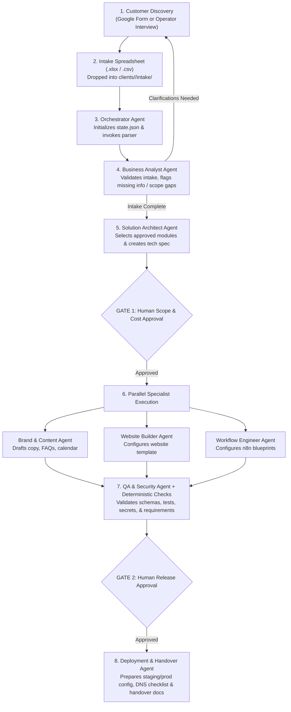

# OrchBiz — Reusable AI Service Delivery Platform

> **A lean, agent-driven service delivery workspace for a one-person software services business.**  
> Instead of building seven heavyweight internal SaaS tools before serving a single customer, **OrchBiz** combines a **Google Form / Excel Intake Questionnaire**, a **Versioned Reusable Template Catalogue**, **Specialist AI Agents**, and **Deterministic Validation** to assemble, test, and deliver client solutions safely and repeatably.

---

## 1. Core Philosophy & Architectural Shift

The original platform blueprint proposed **7 separate internal applications** (Client Intake UI, Project Orchestrator UI, Website Studio, Automation Studio, Content Studio, QA Centre, and Client Operations Portal) backed by a shared platform core.

For a **one-person business**, building and maintaining 7 internal UIs is premature overhead when **AI agents + structured files + deterministic CLI validators** can perform the internal assembly work.

### Do We Need All 7 Applications? (Evaluation Summary)

| # | Blueprint Application | Verdict | Lean Agent-First Replacement in `orchbiz` |
|---|---|---|---|
| **1** | **Client Intake & Package Builder** | **Replace with Form/Excel** | A **Google Form / Excel Questionnaire** filled out by the customer (or by you during discovery). Responses export to `.xlsx` / `.csv` and drop into `clients/<slug>/intake/`. |
| **2** | **Project Orchestrator** | **Replace with Orchestrator Agent + State File** | The **Orchestrator Agent** reads the Excel intake, tracks state in `clients/<slug>/state.json`, delegates to specialist agents, and pauses at explicit human approval gates. |
| **3** | **Website & Brand Studio** | **Replace with Template Catalogue + Agent** | Versioned code templates in `catalogue/websites/` configured by the **Brand & Content Agent** and **Website Builder Agent** into a previewable client build. |
| **4** | **Automation Blueprint Studio** | **Replace with n8n Blueprints + Agent** | Parameterized n8n/workflow JSON blueprints in `catalogue/automations/` configured by the **Workflow Engineer Agent** and validated against schemas. |
| **5** | **Content Production Studio** | **Replace with Structured Agent Outputs** | **Brand & Content Agent** generates structured Markdown/JSON/CSV deliverables (`copy.md`, `faqs.json`, `social-calendar.csv`) directly in the client workspace. |
| **6** | **QA & Release Centre** | **Replace with CLI Validators + QA Agent** | Deterministic validation scripts + the **QA & Security Agent** verify requirements vs. deliverables, inspect test evidence, check secret hygiene, and produce a release gate checklist. |
| **7** | **Client Operations Portal** | **Defer to Phase 4** | Replaced initially by a generated **Handover Runbook** (`handover.md`) and the customer's own lightweight **Lead Dashboard** module. Build a portal only when managing 5+ recurring retainer clients. |

> **What we actually build as software:**  
> We focus engineering effort on the **reusable customer-facing modules** inside `catalogue/` (e.g., the *Lead-to-Appointment System*: Landing Page, Enquiry Form, Lead API/Database, n8n Follow-up & Booking Workflows, and Client Lead Dashboard) and **deterministic validation scripts**—not internal bloatware.

See [`docs/architecture-evaluation.md`](file:///c:/Users/2478356/projects/orchbiz/docs/architecture-evaluation.md) for the full trade-off analysis.

---

## 2. End-to-End Delivery Workflow (Excel-to-Agent Pipeline)



---

## 3. Workspace Structure

```text
orchbiz/
├── README.md                          # Platform overview & operating model
├── .gitignore                         # Protects client secrets, .env, and raw PII
├── docs/
│   ├── architecture-evaluation.md     # Detailed review of the 7 apps vs. Agent-First approach
│   ├── intake-questionnaire-spec.md   # Google Form / Excel questionnaire questions & mapping
│   ├── agent-workflow.md              # Multi-agent orchestration protocol & approval gates
│   └── git-workflow.md                # Mandatory CLI-only Git commit & push policy (account isolation)
├── intake/
│   ├── intake.schema.json             # Canonical JSON Schema for validated client intakes
│   └── questionnaire-template.csv     # Ready-to-use Excel/Google Sheets template with sample row
├── catalogue/
│   ├── README.md                      # Rules for authoring & versioning reusable templates
│   ├── template.schema.json           # Metadata contract required for every template module
│   ├── packages/
│   │   └── starter-lead-to-appointment.json # Starter package definition (Coaching Niche)
│   ├── websites/                      # Reusable website & UI component templates
│   └── automations/                   # Reusable n8n / automation workflow blueprints
├── agents/
│   ├── README.md                      # Agent roster, boundaries, and invocation guide
│   └── prompts/                       # System prompts & output contracts for each agent role
│       ├── 00-orchestrator.md
│       ├── 01-business-analyst.md
│       ├── 02-solution-architect.md
│       ├── 03-brand-and-content.md
│       ├── 04-website-builder.md
│       ├── 05-workflow-engineer.md
│       ├── 06-qa-and-security.md
│       └── 07-deployment-and-handover.md
└── clients/
    ├── README.md                      # Client isolation rules & per-client folder layout
    └── _template/                     # Skeleton copied for each new client engagement
        └── state.json                 # Tracks project phase, module selections, approvals & logs
```

---

## 4. Recommended Starting Offer (Phase 1–2 Focus)

- **Target Niche:** Coaching & Training Institutes (or comparable local service businesses).
- **Starter Package:** `starter-lead-to-appointment` ([package spec](file:///c:/Users/2478356/projects/orchbiz/catalogue/packages/starter-lead-to-appointment.json))
- **Bundled Reusable Modules:**
  - **Website Modules:** `business-landing-page`, `services-and-pricing`, `enquiry-form`, `appointment-booking`, `lead-dashboard`
  - **Automation Modules:** `capture-and-store-lead`, `notify-business-owner`, `classify-enquiry`, `draft-follow-up`, `schedule-appointment`, `send-approved-reminder`

---

## 5. Operating Guardrails (Non-Negotiable)

1. **Reuse Over Invention:** Agents select and configure tested templates from `catalogue/`; they do not invent bespoke architectures from scratch unless explicitly authorized.
2. **AI Proposes, Deterministic Code Validates:** Agents interpret Excel inputs and draft configs/content; schemas and deterministic test suites verify outputs before release.
3. **Strict Tenant Isolation:** Every customer's intake sheet, config, credentials reference, and deliverables live in an isolated `clients/<client-slug>/` workspace (with secrets excluded from Git).
4. **Zero Unverified Claims:** Agents must never fabricate customer testimonials, certifications, or business metrics; placeholders requiring client verification are explicitly flagged.
5. **Human Approval Gates:** External messaging, paid API usage, DNS/domain changes, and production deployments always require explicit operator sign-off in `state.json`.
6. **Legal & Compliance Hygiene:** Operate exclusively on personal devices, accounts, and time; maintain clear written scopes, revision limits, and customer-owned infrastructure handover.
7. **CLI-Only Git Account Isolation:** Always commit and push using the Git CLI with repository-local identity (`samuelvalla-9` / `samuelvictorvalla@gmail.com`)—never via the IDE Git UI. See [`docs/git-workflow.md`](file:///c:/Users/2478356/projects/orchbiz/docs/git-workflow.md).

---

## 6. How to Start a New Client Engagement

1. **Collect Intake:** Have the client fill out the Google Form, or fill out [`intake/questionnaire-template.csv`](file:///c:/Users/2478356/projects/orchbiz/intake/questionnaire-template.csv) yourself during a discovery call and save it as `.xlsx` or `.csv`.
2. **Initialize Client Folder:** Copy `clients/_template/` to `clients/<client-slug>/` and place the response sheet in `clients/<client-slug>/intake/`.
3. **Trigger Orchestrator:** Point the **Orchestrator Agent** ([`agents/prompts/00-orchestrator.md`](file:///c:/Users/2478356/projects/orchbiz/agents/prompts/00-orchestrator.md)) at the client intake file to run Step 1 (Business Analyst intake validation) and Step 2 (Solution Architect technical specification).
4. **Review & Approve:** Review the generated scope and module plan at **Gate 1**, approve, and let the specialist agents generate the deliverables.
