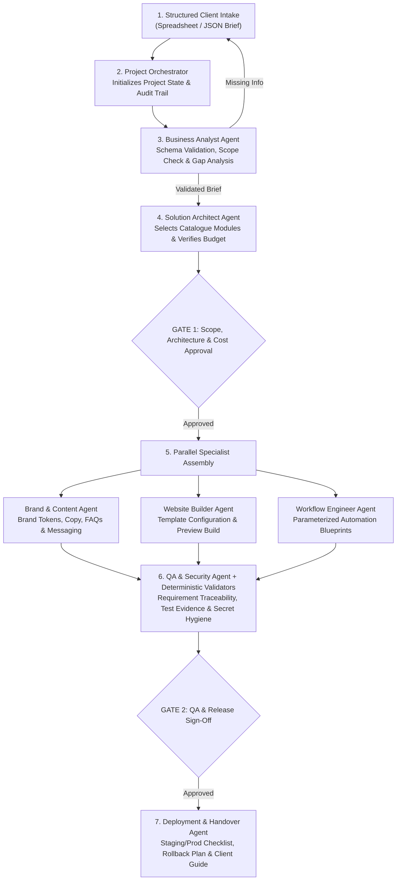

# OrchBiz — Reusable AI Service Delivery Platform

**OrchBiz** is a modular, multi-agent service delivery architecture designed to turn structured customer briefs into tested, production-ready web and workflow automation systems.

Instead of treating every client engagement as a bespoke build from scratch, **OrchBiz** combines a **Structured Intake Schema**, a **Versioned Template Catalogue**, **Specialist AI Agents**, and **Deterministic Validation**—keeping consequential actions behind explicit human approval gates.

---

## Key Capabilities

- **Template-First Engineering:** Assembles solutions from pre-tested, versioned website modules and workflow automation blueprints rather than generating untested code from scratch.
- **Schema-Driven Intake Pipeline:** Ingests structured customer requirements (via spreadsheet/form exports) and validates them against strict JSON Schemas before planning begins.
- **Multi-Agent Collaboration with Human Gates:** Specialist agents handle requirement analysis, architecture mapping, brand copy, website configuration, workflow parameterization, and QA—pausing at mandatory human review gates.
- **Deterministic Quality & Security Enforcement:** Every template defines explicit input/output schemas, required permissions, cost estimates, test cases, and rollback procedures.
- **Strict Tenant Isolation:** Customer configurations, deliverables, state tracking, and credential references are isolated per engagement.

---

## System Architecture & Delivery Workflow



---

## Reusable Template Catalogue

Every module in [`catalogue/`](catalogue/README.md) adheres to the [`template.schema.json`](catalogue/template.schema.json) contract, specifying its semantic version, input/output schemas, dependencies, supported integrations, configuration fields, operating cost estimate, required permissions, test cases, and rollback approach.

### Website Modules (`catalogue/websites/`)
| Module ID | Purpose |
|---|---|
| `business-landing-page` | Responsive hero, value proposition, trust signals, and primary call-to-action layout |
| `services-and-pricing` | Structured course/service cards, duration, pricing tiers, and feature comparison |
| `enquiry-form` | Validated lead capture form connected to backend API and webhook triggers |
| `appointment-booking` | Calendar slot selection / scheduling integration for consultations or demo sessions |
| `faq-assistant` | Structured FAQ accordion and verified knowledge-base responses |
| `lead-dashboard` | Lightweight client-facing dashboard for viewing enquiries, status, and booked appointments |
| `social-content-calendar` | Structured content schedule, captions, and campaign planner |

### Automation Blueprints (`catalogue/automations/`)
| Blueprint ID | Purpose |
|---|---|
| `capture-and-store-lead` | Validates incoming webhook payload, deduplicates, and persists lead to database/sheet |
| `notify-business-owner` | Sends instant staff notifications via Email, WhatsApp template, or Slack/Telegram |
| `classify-enquiry` | Uses narrowly scoped LLM extraction to tag intent, urgency, and service interest |
| `draft-follow-up` | Prepares personalized, brand-aligned follow-up drafts for review or approved sending |
| `schedule-appointment` | Syncs confirmed bookings with Google Calendar / scheduling providers |
| `send-approved-reminder` | Dispatches pre-approved appointment reminders prior to scheduled sessions |
| `weekly-performance-report` | Aggregates enquiry volume, conversion metrics, and pipeline summary |

---

## Flagship Package: Lead-to-Appointment System

The platform's reference package ([`starter-lead-to-appointment.json`](catalogue/packages/starter-lead-to-appointment.json)) bundles an end-to-end lead capture, qualification, instant staff notification, follow-up drafting, appointment booking, and tracking pipeline tailored for service and training businesses.

- **Recommended Stack:** Angular (Frontend), Spring Boot (REST API), PostgreSQL (Persistence), and n8n (Workflow Automation).
- **AI Usage Policy:** Models are used selectively for classification, extraction, summarization, and drafting; deterministic code enforces validation, routing rules, and permissions.

---

## Specialist Agent Roster

| Agent Role | Responsibility | Specification |
|---|---|---|
| **Project Orchestrator** | Owns project state, task routing, audit logs, and human approval gate enforcement | [`00-orchestrator.md`](agents/prompts/00-orchestrator.md) |
| **Business Analyst Agent** | Validates intake against schema, identifies missing inputs, and enforces package scope | [`01-business-analyst.md`](agents/prompts/01-business-analyst.md) |
| **Solution Architect Agent** | Selects approved catalogue templates, maps integrations, and verifies budget limits | [`02-solution-architect.md`](agents/prompts/02-solution-architect.md) |
| **Brand & Content Agent** | Drafts brand voice tokens, website copy, FAQs, and messaging templates without fabricating claims | [`03-brand-and-content.md`](agents/prompts/03-brand-and-content.md) |
| **Website Builder Agent** | Binds approved copy and theme tokens into website templates and prepares previews | [`04-website-builder.md`](agents/prompts/04-website-builder.md) |
| **Workflow Engineer Agent** | Configures automation blueprints, environment variable templates, and webhook test plans | [`05-workflow-engineer.md`](agents/prompts/05-workflow-engineer.md) |
| **QA & Security Agent** | Audits requirement traceability, test evidence, secret hygiene, and release readiness | [`06-qa-and-security.md`](agents/prompts/06-qa-and-security.md) |
| **Deployment & Handover Agent** | Produces deployment checklists, rollback runbooks, and client handover documentation | [`07-deployment-and-handover.md`](agents/prompts/07-deployment-and-handover.md) |

---

## Operating Guardrails

1. **Reuse Over Invention:** Solutions are composed from tested catalogue modules rather than generated ad-hoc.
2. **AI Proposes, Code Validates:** Structured outputs are validated against JSON Schemas and automated checks prior to release.
3. **Zero Fabricated Claims:** Agents never invent testimonials, certifications, or business metrics; unverified claims are explicitly flagged for client confirmation.
4. **Explicit Approval Gates:** External messaging activation, paid API usage, DNS changes, and production deployments require explicit human sign-off.
5. **Tenant & Secret Isolation:** Client data and deliverables remain isolated per workspace, and credentials are referenced exclusively via environment templates.

---

## Repository Structure

```text
orchbiz/
├── README.md                          # Architecture overview & platform documentation
├── docs/
│   ├── architecture-evaluation.md     # Lean agentic delivery model vs. traditional internal tooling
│   ├── intake-questionnaire-spec.md   # Client intake questionnaire specification & field mapping
│   ├── agent-workflow.md              # Multi-agent collaboration protocol & approval gates
│   ├── copilot-agents-setup.md        # Instructions for configuring selectable IDE Copilot Agents
│   └── orchbiz-setup-and-trial-run-guide.md  # Step-by-step usage, trial run, current status & roadmap
├── intake/
│   ├── intake.schema.json             # JSON Schema for validating customer intake briefs
│   └── questionnaire-template.csv     # Sample intake template (Fictional Coaching Institute demo)
├── catalogue/
│   ├── README.md                      # Template authoring & versioning guide
│   ├── template.schema.json           # Required metadata contract for all catalogue modules
│   ├── fx-rates.json                  # Operator-maintained currency rates for budget checks
│   ├── packages/                      # Bundled service package definitions
│   ├── websites/                      # Website module manifests (contract-only, v0.1.0)
│   └── automations/                   # Automation manifests + n8n blueprints (*.workflow.json)
├── platform/
│   ├── lead-api/                      # Spring Boot lead API: POST /api/leads, Postgres, n8n event outbox
│   └── local/postgres-init/           # DB bootstrap used by docker-compose
├── docker-compose.yml                 # Local stack: PostgreSQL + n8n + lead API (copy .env.example → .env)
├── .env.example                       # Placeholder variables for the local stack (never commit .env)
├── .github/workflows/ci.yml           # CI: build/test CLI + lead API, validate catalogue, scan secrets
├── schemas/                           # JSON Schemas for state and every agent output artifact
├── tools/
│   ├── README.md                      # OrchBiz CLI commands, exit codes & hook install
│   ├── orchbiz.ps1 / orchbiz          # CLI wrappers (build the jar on first run)
│   ├── orchbiz-cli/                   # Java 17 / Maven source and tests for the CLI
│   └── hooks/pre-commit               # Blocks client files and secrets from being committed
├── agents/
│   ├── README.md                      # Agent roster & responsibilities
│   └── prompts/                       # Role prompts and input/output contracts (00 through 07)
└── clients/
    ├── README.md                      # Per-client isolation structure
    └── _template/                     # State machine & directory skeleton for client projects
```
