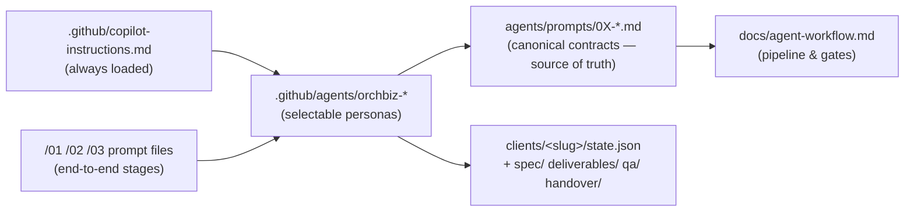

# OrchBiz Setup & Trial Run Guide

This guide explains how the OrchBiz GitHub Copilot agent setup works, walks through a full trial run using the sample intake, and lists what currently works, what is a stub, and how to move to a working or complete system.

> **Status snapshot (2026-10-29):** OrchBiz currently works as an **agent-driven specification and documentation pipeline**. The agents can read an intake, validate it, plan from the package definition, and produce documents and configuration drafts. It does **not** yet deliver a working website or automation, because the reusable catalogue modules, validation scripts and runtime stack have not been built.

---

## 1. What Was Set Up

| Path | Purpose |
|---|---|
| `.github/agents/*.agent.md` (8 files) | Selectable custom agents (`orchbiz-orchestrator`, `orchbiz-business-analyst`, `orchbiz-solution-architect`, `orchbiz-brand-content`, `orchbiz-website-builder`, `orchbiz-workflow-engineer`, `orchbiz-qa-security`, `orchbiz-deployment-handover`). Each one links to its canonical contract in `agents/prompts/`. |
| `.github/chatmodes/*.chatmode.md` (8 files) | Identical copies for older VS Code versions that use chat modes. **If you edit an agent, edit both copies.** |
| `.github/prompts/01-ingest-client-intake.prompt.md` | `/01-ingest-client-intake`: Stage 0 through Stage 2, then stops at Gate 1. |
| `.github/prompts/02-generate-deliverables.prompt.md` | `/02-generate-deliverables`: checks Gate 1, then runs Stage 3 (content, website and workflows). |
| `.github/prompts/03-run-qa-and-handover.prompt.md` | `/03-run-qa-and-handover`: Stage 4 QA, stops at Gate 2, then runs Stage 5 handover if Gate 2 is approved. |
| `.github/copilot-instructions.md` | Workspace-wide rules that apply to every chat: operating model, state tracking, gates and guardrails. |
| `.vscode/settings.json` | Turns on agents, mode files, prompt files and instruction files, and points them to `.github/`. |

### How the pieces relate



The canonical contracts in `agents/prompts/` are the source of truth. The `.agent.md` files are thin wrappers that make those contracts selectable in Copilot Chat. If a contract changes, update the matching agent and chat-mode files.

---

## 2. One-Time Setup Steps

1. **Check that you have the required tools.**
   - VS Code with GitHub Copilot and Copilot Chat. The latest version is recommended because custom agents and prompt files are recent features.
   - Git CLI, configured as described in [`docs/git-workflow.md`](git-workflow.md).
   - Java 17+ and Maven 3.9+ for the OrchBiz CLI (`tools/README.md`). The first `.\tools\orchbiz.ps1` call builds it.
   - Install the commit guard once per clone: `git config core.hooksPath tools/hooks`.
   - *(Phase B)* Node 20+ and the Angular CLI for the website template; Docker or a hosted n8n/Postgres for automations.
2. **Open the folder** `orchbiz/` as the workspace root, so `.github/` and `.vscode/` are at the top level.
3. **Reload the window** using `Ctrl+Shift+P` and **Developer: Reload Window** so Copilot picks up the new files.
4. **Check that the agents are available.**
   - Open Copilot Chat with `Ctrl+Alt+I`.
   - Open the **agent / mode dropdown** at the bottom of the chat input. It shows `Ask`, `Edit`, `Agent` and the custom agents.
   - Confirm that all eight `orchbiz-*` entries appear.
   - Type `/` in the chat input and confirm that `01-ingest-client-intake`, `02-generate-deliverables` and `03-run-qa-and-handover` appear.
5. **Check that the workspace instructions are applied.** Ask Copilot *"What are the OrchBiz approval gates?"* It should describe Gate 1 and Gate 2 without being given a file.
6. **Commit the setup files** using the CLI, as described in [`docs/git-workflow.md`](git-workflow.md):
   ```powershell
   git status --short   # expect .github/, .vscode/settings.json, docs/ — and NOTHING under clients/<slug>/
   git add .gitattributes .github .vscode/settings.json docs README.md agents catalogue intake schemas tools clients/README.md
   git -c user.name="samuelvalla-9" -c user.email="samuelvictorvalla@gmail.com" commit -m "feat: add OrchBiz Copilot agents, CLI, schemas and catalogue manifests"
   ```

> **JetBrains / Visual Studio users:** Support for `.github/copilot-instructions.md` and prompt files is broad. Support for custom agents (`.agent.md`) depends on the Copilot plugin version. If the agents do not appear, attach the matching `agents/prompts/0X-*.md` file to the chat and say *"act as this agent"*. The result is the same.

---

## 3. Trial Run: `apex-coaching` (Fictional Sample Client)

The sample row in [`intake/questionnaire-template.csv`](../intake/questionnaire-template.csv) describes a fictional coaching institute. Before this guide was written, that row was checked against the intake schema:

- **0 schema errors** across all 37 columns. List fields such as `website_modules` were split on commas.
- `ai_data_consent` is `true`.
- **No out-of-scope modules.** Every requested website and automation module is included in `starter-lead-to-appointment`.

That means Stage 1 should pass without blocking issues. The expected result of later stages is described honestly at each step.

### Step 0: Create the client workspace

```powershell
.\tools\orchbiz.ps1 init-client apex-coaching --business-name "Apex Coaching"
Copy-Item intake\questionnaire-template.csv clients\apex-coaching\intake\response.csv
git check-ignore -v clients/apex-coaching/intake/response.csv   # must print a .gitignore match
.\tools\orchbiz.ps1 parse-intake apex-coaching                  # optional: the agent runs this too
```

`clients/*` is git-ignored except `_template/` and `README.md`, so the trial client's data will not be committed.

### Step 1: Ingest the intake and run architecture planning (stops at Gate 1)

In Copilot Chat, select **Agent** mode or `orchbiz-orchestrator`, then send:

```
/01-ingest-client-intake client-slug: apex-coaching, intake: clients/apex-coaching/intake/response.csv.
This is a TRIAL RUN using the fictional sample intake.
```

**Expected outputs:**

| File | Expected content |
|---|---|
| `clients/apex-coaching/state.json` | Created from the template, with `clientSlug: apex-coaching` and status `AWAITING_GATE1_APPROVAL`. It should also contain audit log entries. |
| `intake/intake.validated.json` | The 37 fields normalized. List columns become arrays and `ai_data_consent` becomes the boolean `true`. |
| `spec/requirements-brief.md` | Business overview, 5 website modules and 6 automation modules, 3 offerings, 7 enquiry fields, and notification/booking rules. |
| `spec/clarification-questions.md` | Likely non-blocking questions. For example: the INR budget compared with USD-denominated module costs, which WhatsApp Business provider to use for the approved template, and whether PostgreSQL or Google Sheets is the system of record. |
| `spec/architecture-plan.json`, `spec/technical-spec.md` | Mermaid data flow, webhook contracts, and a budget table comparing INR 2,500/month with the estimate. |

> ⚠️ **Expected limitation:** all module manifests exist, so versions, dependencies and costs are checkable (`check-budget` reports USD 24/month against ~USD 28.41). But most modules are `implementationStatus: contract-only`, and the two `in-development` ones are not yet verified on a real stack. So a correct agent marks the generated configuration as **draft** and does not claim a working build. Reject output that invents versions or costs that differ from the manifests.

### Step 2: Approve Gate 1 as a human

Review `requirements-brief.md` and `technical-spec.md`. Then edit `clients/apex-coaching/state.json` yourself:

```json
"gate1_scope_and_architecture": {
  "required": true,
  "approved": true,
  "approvedBy": "samuelvalla-9",
  "approvedAt": "2026-10-29T18:00:00+05:30",
  "notes": "Trial run — provisional architecture accepted for testing."
}
```

Agents are instructed never to change this flag for you.

### Step 3: Generate the deliverables

```
/02-generate-deliverables client-slug: apex-coaching
```

**Expected outputs** under `clients/apex-coaching/deliverables/`:

- `content/brand-voice.md` uses `#1E3A8A` and `#F59E0B` and a professional, supportive tone.
- `content/website-copy.json` includes the hero, services, differentiators, FAQ, CTA and footer sections. The testimonial section uses only the single provided quote from Aarav K., listed in `unverified-claims-flag.md`.
- `content/message-templates.md` and `content/unverified-claims-flag.md`.
- `website/site.config.json` and `website/preview-instructions.md`.
- `automations/workflows-config.json`, n8n workflow JSON, `env.template` and `workflow-test-plan.md`.

> ⚠️ **Expected limitation:** These outputs are **drafts of configuration and documentation**. No website template exists to apply `site.config.json` to, so you cannot run a preview. Any n8n JSON is written by the agent rather than derived from a tested blueprint, so treat it as a sketch. Do not treat it as importable or tested.

**Negative test:** Before Step 2, set Gate 1 back to `false` and run `/02-generate-deliverables`. The agent should refuse and list the Gate 1 artifacts that need review.

### Step 4: Run QA and stop at Gate 2

```
/03-run-qa-and-handover client-slug: apex-coaching
```

**Expected:**

- `qa/qa-report.json` and `qa/release-checklist.md` are created.
- **QA should report `FAILED` or not ready for release.** No tests have been run and there is no preview or workflow-execution evidence. Under the contract, *"a claimed pass without test evidence must be marked FAILED."* For this trial, a failed QA result means the guardrails are working correctly.
- The agent stops and asks for Gate 2 approval.

### Step 5 (optional, trial only): Approve Gate 2 and generate handover documents

To see the handover templates, set `approvals.gate2_release_and_deploy.approved` to `true` with trial notes, then run `/03-run-qa-and-handover client-slug: apex-coaching` again. The agent should create:

- `handover/deployment-runbook.md`
- `handover/client-handover-guide.md`
- `handover/maintenance-and-rollback.md`

These are instruction documents only. Nothing is deployed.

**Negative test:** With Gate 2 still `false`, a chat message such as *"I approve, go ahead"* must **not** unlock Stage 5. Only the value in `state.json` counts.

### Step 6: Clean up

```powershell
Remove-Item -Recurse -Force clients\apex-coaching
git status --short   # should show no clients/ entries
```

### Trial run checklist

- [ ] All eight `orchbiz-*` agents and all three `/` prompts are visible.
- [ ] Stage 1 produces a validated intake with no blocking questions.
- [ ] The architecture uses the manifest versions and costs, copies `check-budget --json` into `costEstimate`, and labels contract-only modules as drafts.
- [ ] `/02` refuses when Gate 1 is `false`.
- [ ] The testimonial is flagged, and no new claims or statistics are added.
- [ ] `env.template` contains only placeholders and no secret values.
- [ ] QA reports **not passed** because there is no test evidence.
- [ ] A chat message alone does not unlock Stage 5.
- [ ] `git status` never shows files under `clients/apex-coaching/`.

---

## 4. Current Capability Matrix

### ✅ Working now

| Capability | How it works today |
|---|---|
| Selectable specialist agents and stage prompts | `.github/agents`, `.github/chatmodes` and `.github/prompts` |
| Workspace-wide guardrails | `.github/copilot-instructions.md` |
| Intake schema (consent, enums, normalized budget amount/currency) | `intake/intake.schema.json`. The sample CSV passes. |
| CSV **and `.xlsx`** intake parsing | `.\tools\orchbiz.ps1 parse-intake <slug>` writes `intake.validated.json` only when it is schema-valid. |
| Package scope definition and check | `catalogue/packages/starter-lead-to-appointment.json` + `check-scope` |
| Module manifests | All 14 manifests pass `validate-catalogue`. `capture-and-store-lead`, `notify-business-owner`, `classify-enquiry` and `draft-follow-up` are `0.2.0 in-development`; the other 10 are `0.1.0 contract-only`. |
| Lead API | `platform/lead-api`: `POST /api/leads` with validation, tenant isolation, dedupe window, honeypot, PostgreSQL via Flyway, and a `lead.created` outbox delivered to one or more n8n webhooks with a shared-token header, per-IP rate limiting, and admin write-back endpoints for classifications and follow-up drafts (drafts are always `awaiting-approval`). 28 automated tests run on H2 (PostgreSQL mode), and `tools/smoke/lead-api-smoke.ps1` passes against a locally running instance. |
| CI | `.github/workflows/ci.yml` builds and tests the CLI and lead API, validates the catalogue and blueprints, runs the n8n Code-node tests, and scans for secrets. |
| Output schemas | `schemas/` covers `state`, `architecture-plan`, `website-copy`, `site-config`, `workflows-config`, `qa-report`, `package`. |
| Budget check | `check-budget` sums manifest costs + base infrastructure and converts the client budget with `catalogue/fx-rates.json`. |
| Per-client state and isolation | `init-client`, `.gitignore` rules for `clients/*`, `validate-client` cross-client checks, and the pre-commit hook. |
| Gate enforcement | `check-gate <slug> gate1\|gate2` requires `approved`, `approvedBy` and `approvedAt`; every agent contract calls it. |
| Secret scanning | `scan-secrets` (regex rules) for deliverables, and on every commit via `tools/hooks/pre-commit`. |
| Specification and document generation | Requirements brief, technical spec, copy, message templates, QA report and handover documents |
| Git identity and push procedure | `docs/git-workflow.md` |

### 🟡 Partial / stub

| Area | Current state | Risk |
|---|---|---|
| `catalogue/websites/` | Manifests only. No Angular template code yet. | `site.config.json` is a validated draft; there is nothing to render a preview. |
| `catalogue/automations/` | Three blueprints exist: `notify-business-owner` (email only, dry-run/staging), `classify-enquiry` (consent-gated LLM labelling) and `draft-follow-up` (template drafts saved as `awaiting-approval`, never sent). Their structure is checked by the CLI and the Code-node logic is unit-tested with Node, but **none has been imported into a running n8n**. The other automations are manifests only. | Import them and run NBO/CLE/DFU tests before relying on them. There is no draft approval UI yet. |
| Lead API runtime | Tested on H2 only. `docker-compose.yml` and the Dockerfile are written but have not been run, because the corporate device has no Docker. | Run `docker compose up` on a machine with Docker and repeat CSL-01..04 against real PostgreSQL. |
| Cost figures and FX rates | Operator estimates in manifests, package `baseInfrastructure` and `fx-rates.json`. | Confirm with real provider pricing before quoting a client. |
| Gate enforcement | CLI + agent contracts + pre-commit hook + CI checks. | A manual edit outside the agents could still skip a gate. |
| Orchestration | Manual. You run `/01`, `/02` and `/03` yourself. | Matches the Phase 1 design, but nothing runs unattended. |
| Copilot settings | Setting keys and tool names, such as `codebase` and `runCommands`, change between VS Code releases. They have not yet been confirmed in the IDE. | Agents may appear without some tools. Check §2 step 4. |

### ❌ Not implemented

- Website runtime: the Angular templates. On the corporate device, npm is blocked by the proxy certificate (`SELF_SIGNED_CERT_IN_CHAIN`). Build them on a personal device, or ask IT for the corporate root CA (`NODE_EXTRA_CA_CERTS`) or an internal npm mirror.
- A running n8n instance. The compose file is ready but has not been run, and no hosting has been chosen.
- Automated tests of website deliverables: Playwright and Lighthouse/axe. (An API smoke test exists: `tools/smoke/lead-api-smoke.ps1`.)
- Staging and production deployment targets.
- A headless orchestrator triggered by form submission (Phase 3).
- The Operations & Optimization agent (deferred to Phase 4).

### Documentation inconsistencies (fixed in Phase A)

1. `catalogue/README.md` now lists `estimatedMonthlyCostUSD`, matching `template.schema.json`.
2. `docs/agent-workflow.md` now sends out-of-scope items to the requirements brief via `check-scope` instead of `scope-warnings.md`.
3. The `state.json` `status` values are enforced by `schemas/state.schema.json` and explained in `docs/agent-workflow.md` §3.
4. `architecture-evaluation.md` now refers to `brand-voice.md` and `qa-report.json`.

---

## 5. Roadmap to a Working System

### Phase A: Working capacity, with deterministic specifications — ✅ done

Delivered: the Java 17 OrchBiz CLI (`tools/README.md`), output schemas in `schemas/`, normalized budget fields, 14 contract-only manifests, `fx-rates.json`, the pre-commit hook, CLI calls wired into every agent contract and stage prompt, and the documentation fixes above.

**Phase A exit test (passed):** the sample intake goes through `init-client` → `parse-intake` → `check-scope` → `check-budget` (USD 24 vs ~USD 28.41 budget) → `check-gate gate1` (blocked until approved with approver and timestamp). Architecture plans remain labelled draft while modules are `contract-only`.

### Phase B: Minimal working product, an end-to-end demo for one client (about 3–6 weeks) — 🟡 in progress

1. **Website template** — ⏳ pending. Build one parameterized **Angular** template that renders entirely from `site.config.json` and `website-copy.json`, in `catalogue/websites/`. This needs Node 20+ and the Angular CLI; npm is blocked on the corporate device. The form posts to the lead API using the `enquiry-form` payload contract.
2. **Lead API and storage** — ✅ built and unit-tested (`platform/lead-api/README.md`). Remaining: run it against real PostgreSQL.
3. **n8n blueprints** — 🟡 `notify-business-owner`, `classify-enquiry` and `draft-follow-up` are written, structure-checked and logic-tested; import them and run NBO/CLE/DFU tests. Capture is handled by the lead API, not n8n.
4. **Local stack** — 🟡 `docker-compose.yml` + `.env.example` are written but have not been run. `make preview CLIENT=<slug>` is still to do and depends on the website template.
5. **Test evidence** — 🟡 `tools/smoke/lead-api-smoke.ps1` covers the API contract tests. Still to add: Playwright checks for form validation and successful submission, axe and Lighthouse checks for accessibility, and curl/Newman tests from `workflow-test-plan.md`. Save the results in `clients/<slug>/qa/evidence/`, where the QA agent can cite them.
6. **CI** — ✅ `.github/workflows/ci.yml`. Add template tests once the Angular template exists.

**Order for running the local stack (on a machine with Docker):** `copy .env.example .env` and fill in the values → `docker compose up -d --build`. In n8n (http://localhost:5678), create the Header Auth credential `LEAD_EVENTS_WEBHOOK_HEADER_REF` with header `X-OrchBiz-Token` and the value of `LEAD_EVENTS_WEBHOOK_TOKEN`. Also create an SMTP credential `SMTP_CREDENTIAL_REF` that points at a test mailbox. Import `catalogue/automations/notify-business-owner/notify-business-owner.workflow.json` and select both credentials. Activate the workflow (dry-run by default). Register the tenant with `PUT /api/admin/tenants/apex-coaching`, then run `.\tools\smoke\lead-api-smoke.ps1` and check the n8n execution log.

To add classification and drafts: create the Header Auth credential `ORCHBIZ_ADMIN_API_REF` (header `Authorization`, value `Bearer <ORCHBIZ_ADMIN_TOKEN>`). Create `LLM_API_REF` only if the client gave `ai_data_consent`. Import `classify-enquiry.workflow.json` and `draft-follow-up.workflow.json`, edit the `CONFIG` block in each, and activate both. Then add the classify webhook to `LEAD_EVENTS_WEBHOOK_URL` in `.env` and run `docker compose up -d` again. Drafts appear under `GET /api/admin/tenants/<slug>/leads/<leadId>/drafts`.

**Phase B exit test:** The `apex-coaching` trial produces a locally running site. A test enquiry reaches Postgres and creates an owner notification in dry-run mode. QA reports `PASSED` based on real evidence.

### Phase C: Full capacity (ongoing)

- Complete the remaining modules: `appointment-booking` with Google Calendar, `lead-dashboard`, `send-approved-reminder`, `faq-assistant`, `social-content-calendar` and `weekly-performance-report`.
- Add staging and production deployment through IaC or a platform such as Render, Fly, Azure or GCP, with documented rollback. Keep DNS changes and live messaging as operator-only steps.
- Add a headless orchestrator that responds to Google Form submissions, through the Copilot CLI/SDK or an n8n trigger. It should still stop at both gates and notify the operator.
- Add the Phase 4 Operations & Optimization agent, together with retainer reporting.
- Version catalogue modules using semantic versioning, keep a changelog, and add an upgrade path for existing clients.

---

## 6. Day-to-Day Operating Cheat Sheet

| I want to… | Do this |
|---|---|
| Onboard a real client | `.\tools\orchbiz.ps1 init-client <slug> --business-name "<name>"`, copy the CSV/XLSX export into `clients/<slug>/intake/`, and run `/01-ingest-client-intake`. |
| Answer clarification questions | Update the intake file, then run `/01` again. The agent updates its outputs and records the change in the audit log. |
| Approve scope | Edit `approvals.gate1_scope_and_architecture` in `state.json` (set `approved`, `approvedBy`, `approvedAt`), then confirm with `.\tools\orchbiz.ps1 check-gate <slug> gate1`. |
| Build deliverables | Run `/02-generate-deliverables`. |
| Re-run one specialist | Select the specific `orchbiz-*` agent, for example `orchbiz-brand-content`, and name the client slug. |
| Release | Run `/03-run-qa-and-handover`, approve Gate 2 in `state.json` (with `approvedBy`/`approvedAt`), then run `/03` again. |
| Check anything by hand | `.\tools\orchbiz.ps1 validate-client <slug>`, `check-budget <slug>`, `scan-secrets clients/<slug>/deliverables` — see `tools/README.md`. |
| Change an agent's behavior | Edit `agents/prompts/0X-*.md`, then update the matching `.github/agents/*.agent.md` and `.github/chatmodes/*.chatmode.md`. |
