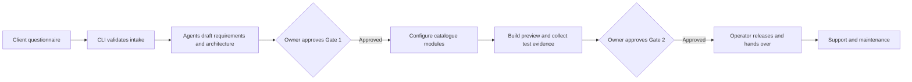
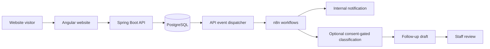

# OrchBiz: How the System Works and the Minimum Viable Product

Status: proposed MVP scope and development specification, not a released product.
Prepared: 2026-11-03.

## 1. What you are building as the owner

OrchBiz is your internal delivery system for selling business automation services. Your clients buy an operational outcome, not a collection of AI agents.

For example, a coaching institute wants enquiries collected reliably, staff alerted, prospective students followed up with approved wording, and appointments managed. OrchBiz helps you deliver that system repeatedly without starting each engagement from an empty codebase.

There are two distinct systems:

| System | Who uses it | Purpose |
|---|---|---|
| Delivery workspace | You and your development agents | Convert requirements into an approved, configured, tested client installation |
| Delivered client system | Client staff and their prospective customers | Run the client's day-to-day enquiry and appointment processes |

The delivery agents do not need to be running for a customer's website to collect an enquiry. Once deployed, the website, API, database and workflows are the operational system.

Your initial business model is a productized service, not a self-service SaaS platform. You manage onboarding, approve scope, configure reusable modules, supervise QA and operate the release process. The repository does not implement checkout, subscriptions, automatic customer provisioning or an autonomous business.

## 2. How the whole system fits together

### Delivery process



### Client runtime



The runtime diagram is the intended flow. The website and staff review UI are not implemented yet; workflows are handwritten blueprints awaiting real n8n verification. Appointment and approved-reminder capabilities belong to the full starter package but are also not implemented.

### Responsibilities of each component

| Component | Responsibility | Not its responsibility |
|---|---|---|
| Questionnaire | Capture business details, requested features, constraints and consent | Grant deployment permission or guarantee feasible scope |
| Catalogue/package manifests | Declare approved modules, versions, dependencies and estimated costs | Prove an implementation exists or tests passed |
| Specialist agents | Propose requirements, copy, configuration, implementation and QA analysis | Invent claims, approve gates or silently expand scope |
| OrchBiz CLI | Enforce the checks it implements, including schemas, scope, budget and gates | Prove all business behavior works in production |
| Angular website | Present approved content and collect validated enquiries | Store operator secrets or access unrestricted admin APIs |
| Spring Boot API | Validate, persist, enforce access rules and expose runtime operations | Treat browser validation as sufficient |
| PostgreSQL | Persist leads, events, classifications and drafts | Send messages or orchestrate agents |
| n8n | Execute configured notification and automation flows | Replace durable storage or human approval |
| Owner/operator | Own scope, consent, credentials, approvals, release and support | Delegate accountability to an AI response |

## 3. The owner workflow for each engagement

### Step 1: Qualify the client and agree the offer

Identify the business problem, purchased package, supported integrations and operating budget. Confirm who owns the domain, email accounts, customer data and third-party subscriptions. Record exceptions rather than promising bespoke features outside the catalogue.

The current full reference package is `starter-lead-to-appointment`. Its manifest is the source of package scope. The smaller MVP in this document is a proposed pilot milestone, not an automatic change to that package.

### Step 2: Create the isolated client workspace

From the repository root:

```powershell
.\tools\orchbiz.ps1 init-client <client-slug>
```

Put the authorized CSV/XLSX questionnaire under `clients\<client-slug>\intake\`. Never use the fictional sample as a real client's answers.

```powershell
.\tools\orchbiz.ps1 parse-intake <client-slug>
```

Resolve failed validation or missing information before continuing.

### Step 3: Run analysis and architecture

Use the orchestrator and specialist contracts in `agents\prompts\`, following `docs\agent-workflow.md`. The business analyst produces requirements and clarification questions. The architect maps requirements to exact catalogue modules and versions.

```powershell
.\tools\orchbiz.ps1 check-scope <client-slug>
.\tools\orchbiz.ps1 check-budget <client-slug> --json
```

Review the actual CLI results. Non-zero exit codes block progress; an agent must not work around the result with an optimistic estimate.

### Step 4: Approve Gate 1 yourself

Review requirements, architecture, integrations, limitations and monthly cost. Only you record approval with `approvedBy` and `approvedAt` in the client's state.

```powershell
.\tools\orchbiz.ps1 check-gate <client-slug> gate1
```

Stage 3 client content, website and workflow generation starts only when this passes.

### Step 5: Generate and configure the deliverables

The content agent prepares approved copy and message templates. The website agent binds that copy and configuration to reusable components. The workflow agent configures only the selected automations and credential references.

Configuration artifacts must follow `schemas\`; implementations must follow their manifests. A module with only a contract remains a draft, not a working deliverable.

### Step 6: Review the preview and real QA evidence

Run schema/client validation, component tests and runtime integration checks. Review the browser preview, database records and workflow executions. Confirm that forbidden claims are absent and no credentials appear in generated content.

The CLI validates artifact structure; browser and integration tests verify behavior. Both matter. A passing schema check alone cannot justify a release.

### Step 7: Approve Gate 2 and release through the operator

Review the release checklist, staging results and client sign-off. Only you record Gate 2 approval.

```powershell
.\tools\orchbiz.ps1 check-gate <client-slug> gate2
```

The deployment agent prepares runbooks; the operator executes approved deployment, credential binding and DNS actions. Gate approval does not authorize an agent to send live messages or provision paid services independently.

### Step 8: Hand over and maintain

Give the client access instructions, operating guidance, support boundaries and a rollback/escalation path. Confirm backups and a restore procedure. Agree who watches failures and responds when an integration stops working.

Maintain engagement state, timestamps and audit history. Client files and evidence stay outside Git; reusable code, schemas and fictional fixtures can be committed.

## 4. Proposed MVP: a reliable enquiry-to-review pilot

### MVP outcome

For one authorized pilot business, a visitor submits an enquiry through a branded website. The enquiry survives service restarts, staff can find it securely, an internal notification is produced, and staff can review a follow-up draft. No customer-facing message is sent automatically.

This is the smallest coherent pilot proposed here. It validates whether you can repeatedly configure and deliver an operational business system. It deliberately does not claim to satisfy the entire Lead-to-Appointment package.

**Owner decision required before selling this narrower offer:** approve the pilot's scope and acceptance terms. If it is sold as a standalone package, create and validate an explicit package definition and matching intake/module selection through the existing tooling. Do not silently drop included scheduling/reminder modules from a purchased starter package.

### Included in the proposed MVP

| Area | Minimum behavior | Current position |
|---|---|---|
| Delivery process | Intake, validated scope/budget, two owner gates, QA evidence and handover | Tooling/contracts exist; end-to-end engagement still needs exercising |
| Public website | Branded landing content, services, accessible enquiry form and clear outcomes | Module contracts only |
| Lead capture | Required-field validation, tenant checks, dedupe, spam trap and rate limiting | API implemented; real PostgreSQL integration not verified |
| Persistence | Leads/events/drafts survive restart; backup and restore demonstrated | Migrations exist; runtime/restore evidence missing |
| Internal notification | One supported channel, dry-run locally and an explicitly approved staff test in staging | Email blueprint exists; actual n8n/SMTP execution unverified |
| Follow-up draft | Approved template draft stored awaiting review; no automatic sending | API and blueprint exist; integration needs exercising |
| Staff review | Authenticated, tenant-restricted lead/draft view | Auth and dashboard not implemented |
| Operations | Reproducible preview, visible failure handling, deployment/rollback instructions | Partial tooling and Compose definition |

AI classification is an optional enhancement, not a prerequisite for reliable capture. The pilot must still work when AI consent is absent or a provider is unavailable.

The current classification workflow triggers drafting only for non-pending classifications. Therefore, a no-AI pilot needs a deliberate, tested template-drafting path independent of successful LLM classification. Do not claim that disabling AI already produces the complete proposed MVP flow.

### Excluded from the proposed MVP

- Automated appointment scheduling and appointment reminders.
- Customer-facing automatic email/WhatsApp sending.
- Multiple notification providers and automatic channel fallback.
- Self-service onboarding, billing, subscriptions or a customer portal for buying packages.
- A headless orchestrator that runs the entire delivery process unattended.
- Optional FAQ assistants, social content automation and weekly reports.
- Multi-instance/high-availability operation and enterprise role hierarchies.

These are deferrals for the narrower pilot, not deletions from the existing starter package contract. A pilot completion must not be reported as completion of that full package.

## 5. MVP acceptance criteria

The MVP is complete only when these outcomes have real evidence:

| ID | Required outcome |
|---|---|
| MVP-01 | A fictional trial engagement passes the canonical process without agents granting either human approval |
| MVP-02 | The Angular preview renders schema-valid client configuration/copy and contains no operator secrets |
| MVP-03 | Browser tests cover required fields, successful capture, duplicate submission, API error and rate-limit feedback |
| MVP-04 | PostgreSQL contains the correct tenant's lead; invalid/unknown-tenant submissions do not create valid leads |
| MVP-05 | Leads and drafts survive a service restart; a backup can be restored in an isolated test environment |
| MVP-06 | Real n8n executions show the intended notification/draft actions, not merely HTTP webhook acceptance |
| MVP-07 | The non-AI path creates an approved-template draft without transmitting enquiry text to an LLM |
| MVP-08 | Drafts remain awaiting review; no customer-facing message is sent by the pilot |
| MVP-09 | Staff authentication and server-side authorization prevent unauthenticated and cross-tenant access |
| MVP-10 | Workflow/write-back failures are visible and recoverable; retry/replay tests check loss and duplicate effects |
| MVP-11 | Required CLI, API, workflow, frontend and integration checks pass; remaining limitations are disclosed |
| MVP-12 | Owner-approved staging evidence, release checklist and operator handover/runbook exist |

Never expose the global admin token in a browser to satisfy MVP-09. Current admin endpoints filter data by the requested tenant path but authorize an operator across tenants; they are not client staff authentication.

Likewise, `notificationStatus: SENT` currently indicates HTTP acceptance by all configured webhook targets, not successful delivery of an email or completion of downstream workflows.

## 6. Build order and milestone boundaries

### Milestone A: reproduce and verify the backend stack

Use `docs\personal-device-agent-handoff.md` for exact bootstrap commands and limitations. Re-run existing checks, start PostgreSQL/n8n/API with Docker, import notification in dry-run mode, run the smoke test and inspect actual workflow execution. Pin the n8n version once verified.

Completion: reproducible stack, real PostgreSQL persistence and documented integration results. This is a technical demo, not the MVP.

### Milestone B: public website and browser-to-database flow

Implement reusable Angular modules, reconcile form-key/schema/API contracts, load validated content/configuration and test browser submission against the API.

Completion: a fictional branded preview captures enquiries reliably. Staff authentication and review may still be missing.

### Milestone C: no-AI drafting, secure staff review and recovery

Implement the template-only draft path, staff authentication/tenant authorization and a minimal review interface. Exercise notification permissions, visible errors, replay/idempotency and recovery.

Choose the supported staff-auth provider with the owner before introducing a significant new dependency. Reuse the dashboard contract; do not build a public admin-token UI as a shortcut.

Completion: the pilot's enquiry-to-review loop works without AI or automatic customer messaging.

### Milestone D: controlled pilot release

Demonstrate backup/restore, complete staging QA, obtain owner/client approvals, prepare operator deployment and support documentation, and release only through authorized actions.

Completion: the MVP acceptance table has evidence and the approved pilot scope can be handed over honestly.

### After the pilot: complete the full starter package

Implement the package's appointment booking, scheduling and approved reminders with their own permission, failure and audit requirements. Add AI classification/personalization only where consent, cost and measurable business value justify them.

Do not prioritize extra agents, new optional modules or orchestration infrastructure ahead of the working customer journey.

## 7. Definition of reusable delivery

One successful installation is not enough to prove the delivery process is reusable. After the first pilot, assemble a second fictional business with different branding, services and field configuration using the same tested modules.

The second assembly should not require copying the first client's private data or creating a bespoke architecture. Record any manual configuration, code changes and integration assumptions discovered during this exercise.

Measure actual delivery effort, defects, support incidents and recurring service costs before making turnaround-time or commercial claims. Do not invent targets or promise pricing based solely on catalogue estimates.

## 8. Present-day status and next action

Today the repository has working Java validation tooling, a tested lead API and three unverified-at-runtime n8n blueprints. It does not yet have a working Angular website, secure staff dashboard, appointment system or production installation.

The immediate next engineering milestone is **Milestone A**, followed by **Milestone B**. The personal-device handoff supplies the detailed continuation instructions. This document defines the intended operating model and proposed MVP; it does not certify that the MVP is built, approved or ready to sell.
